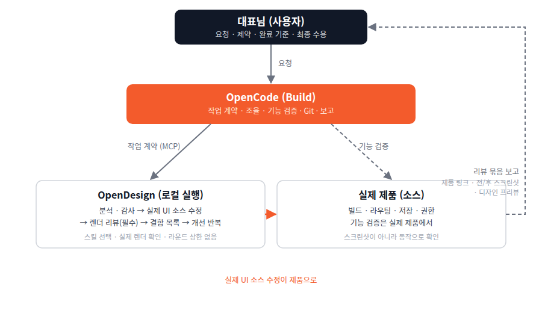
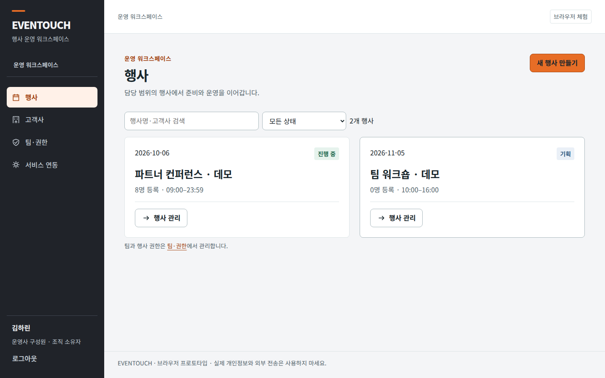
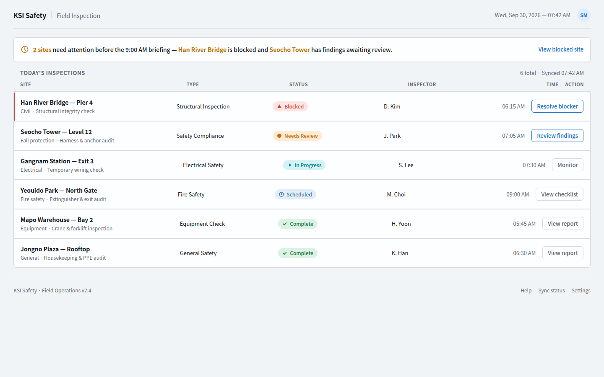
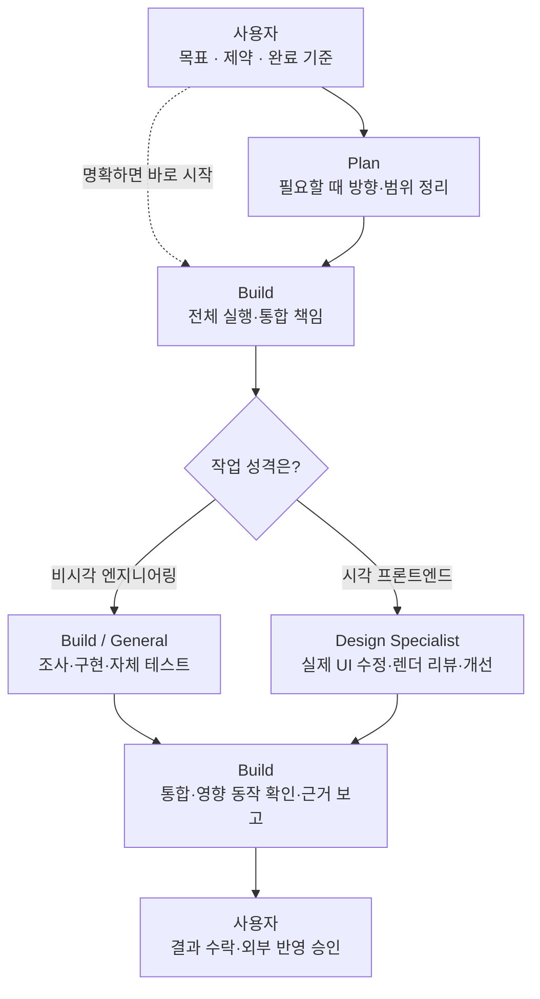

# KSI OpenCode Harness

<div align="center">

**AI에게 일을 맡기되, 방향과 완료 기준은 사람이 정합니다.**

OpenCode V2를 위한 **실무형 작업 방식 + 선택형 설치기** — 필요한 역할만 얹고, 기존 환경은 건드리지 않습니다.

[](https://opencode.ai) [](https://nodejs.org) [](package.json) [](LICENSE) [](https://github.com/khakisketch/KSI-Opencode-Harness/actions/workflows/check.yml)

[빠른 시작](#빠른-시작-30초) · [화면으로 보기](#화면으로-보기) · [현장 데모](#현장-적용-예시시연용-데모) · [동작 방식](#동작-방식) · [문서](#문서) · [문의](#만드는-곳)

</div>

> **이 저장소는 두 가지를 담고 있습니다.**
> ① KSI의 실무 작업 방식(Plan · Build · General · Explore + Design Specialist 중심)과
> ② 필요한 환경에만 깔아 쓰는 선택형 npm 설치기(`developer` · `reviewer` 2개 파일).
> 설치기는 OpenCode · Node · 모델 · 인증 · 디자인 도구를 설치하지 않습니다.

## 한눈에 보기

| 구분 | 내용 |
| --- | --- |
| **하는 일** | 승인된 작업을 끝까지 완주 — 구현 · 통합 · 검증 · 보고를 책임집니다 |
| **설치 범위** | 선택한 설정 폴더에 `agents/developer.md`, `agents/reviewer.md` 2개만 추가 |
| **하지 않는 일** | 기존 파일 자동 삭제 · 전역 설정 변경 · 강제 마이그레이션 없음 |
| **확인 방법** | 미리보기 → 적용 → 에이전트 목록 확인 → `npm run check` |
| **공개 상태** | Public Beta `0.5.0-beta.9` · MIT · npm 로그인 없이 설치 가능 |

## 화면으로 보기

<table>
<tr>
<td width="50%">

**개발 흐름도** — 누가 무엇을 책임지는지 한 장에 정리



</td>
<td width="50%">

**실제 제품 화면 예시** — 한국어 운영 화면 (데모 데이터)



</td>
</tr>
</table>

> 전체 흐름 설명은 [시각 가이드](docs/walkthrough.md)에서 볼 수 있습니다.
> 캡처 일부는 과거 실행 예시이며, 최신 상태 증빙이 아니라 흐름 이해용입니다.

## 현장 적용 예시(시연용 데모)

담당자가 가장 빨리 이해하는 화면 — **현장 안전점검 리스트**를 시연용 데모로 만들었습니다.
현장명은 가상이며, 실제 현장 정보가 아닙니다.



| 현장(가상) | 점검 유형 | 상태 | 조치 |
| --- | --- | --- | --- |
| 한강교량 — 4번 교각 | 구조 점검 | 차단 | 차단 해소 |
| 서초타워 — 12층 | 안전 순찰 | 검토 필요 | 지적사항 검토 |
| 강남역 — 3번 출구 | 전기 안전 | 진행 중 | 모니터링 |
| 여의도공원 — 북문 | 소방 안전 | 예정 | 체크리스트 |
| 마포창고 — 2번 구역 | 장비 점검 | 완료 | 보고서 보기 |
| 종로플라자 — 옥상 | 일반 안전 | 완료 | 보고서 보기 |

- **한글 데모 페이지:** [`docs/demo-safety/index.html`](docs/demo-safety/index.html) — GitHub Pages를 `/docs`로 열면 라이브 주소로 바로 공유됩니다.
- **포인트:** 오전 브리핑 전 “조치가 필요한 2곳” 요약 → 상태 뱃지 → 다음 조치 버튼까지 한 화면. 발주처 보고용으로 그대로 쓸 수 있는 구조입니다.

## 빠른 시작 (30초)

준비물: **Node.js 20+**, **OpenCode V2**, 모델 provider 연결. npm 로그인은 필요 없습니다.

```sh
# 1. 미리보기 — 파일을 바꾸지 않고 쓸 내용을 먼저 보여줍니다
npm exec --yes --package=ksi-opencode-harness@0.5.0-beta.9 -- ksi-opencode install --target "$PWD/.opencode"

# 2. 확인 후 적용 — developer · reviewer 2개만 추가합니다
npm exec --yes --package=ksi-opencode-harness@0.5.0-beta.9 -- ksi-opencode install --target "$PWD/.opencode" --apply
```

Windows PowerShell:

```powershell
npm exec --yes --package=ksi-opencode-harness@0.5.0-beta.9 -- ksi-opencode install --target (Join-Path (Get-Location) ".opencode")
npm exec --yes --package=ksi-opencode-harness@0.5.0-beta.9 -- ksi-opencode install --target (Join-Path (Get-Location) ".opencode") --apply
```

적용되는 것은 딱 두 파일입니다.

```text
선택한 설정 폴더/
└── agents/
    ├── developer.md
    └── reviewer.md
```

> 서버 전체 적용 · 충돌 시 처리 · 소스 체크아웃 설치는 [설치 가이드](INSTALL.md)를 보세요.
> 미리보기와 적용은 같은 버전을 쓰세요. 기존에 있던 Test Runner 등은 남으며 자동 삭제되지 않습니다.

## 이렇게 요청하세요

명령어를 외울 필요 없습니다. 원하는 결과와 제약만 자연어로 주세요.

- **작은 수정:** “저장 실패 후 재시도 로직을 고쳐줘. 화면은 그대로 두고 저장·재시도 검사 결과를 알려줘.”
- **새 기능:** “관리자가 주문을 취소하는 기능이 필요해. 기존 구조와 예외를 먼저 보고 계획을 제안해줘. 승인 후 구현·검증까지 하고 푸시는 하지 마.”
- **화면 개선:** “예약 화면을 실제 소스에서 개선해줘. API·저장 동작은 유지하고 렌더 결과와 검증 결과를 함께 보고해줘.”

## 동작 방식

명확한 작업은 Plan 없이 Build에서 바로 시작합니다. Plan은 필요할 때만 방향·범위를 정리합니다.



| 역할 | 맡는 일 |
| --- | --- |
| **Plan** | 필요할 때 맥락·범위·완료 증거 정리 (상시 단계 아님) |
| **Build** | 승인 작업의 실행·통합·검증·보고 책임 |
| **General** | 맡겨진 비시각 조사·구현·자체 테스트 |
| **Design Specialist** | 시각 판단·실제 UI 수정·렌더 리뷰·개선 (기본 경로) |
| **CE 스킬** | 필요할 때 쓰는 절차 모음 (실행 주체 아님) |

테스트 통과 · 사용자 수락 · 푸시/배포는 서로 다른 상태이며, 외부 반영은 대상·영향 승인이 필요합니다.

## 검증 · 품질

포트폴리오용이라도 검증 근거는 실제로 돌립니다.

```sh
npm run check
npm run check:package
```

- `check`: 소스 문법 + 단위 테스트 (Node 20/22, Ubuntu/macOS/Windows CI)
- `check:package`: 실제 tarball을 격리 환경에서 미리보기 → 적용 → 반복 적용 → 사용자 설정 보호까지 확인
- 검사 통과가 디자인 승인·외부 연동 성공을 뜻하지는 않습니다. 범위는 [검증 안내](docs/verification.md)에 적혀 있습니다.

## 문서

| 알고 싶은 내용 | 문서 |
| --- | --- |
| 설치 대상 · 충돌 · 업그레이드 · 이전 | [설치 가이드](INSTALL.md) |
| 역할 구성 · 패키지 구조 | [아키텍처](docs/architecture.md) |
| 위임 · 통합 · 완료 보고 · 재개 | [실행 흐름](docs/execution.md) |
| 화면 캡처 흐름 설명 | [시각 가이드](docs/walkthrough.md) |
| 문제 해결 · 검증 범위 | [문제 해결](docs/troubleshooting.md) · [검증 안내](docs/verification.md) |
| 운영 지침 예시 | [AGENTS.md 예시](examples/project-AGENTS.md) · [자율 개발 지침](examples/autonomous-development.md) |

<details>
<summary>이미 KSI를 쓰고 있던 환경이라면 (펼치기)</summary>

현재 전역 운영은 네이티브 Plan · Build · General · Explore + 기본 Design Specialist + 선택형 CE 스킬입니다.
Developer · Test Runner · Reviewer, Superpowers, Goal은 전역에서 제거된 상태이므로, 예시만 보고 재설치하지 말고 실제 서버의 유효 설정을 먼저 확인하세요.
이전 공개판 `0.5.0-beta.8`은 Test Runner 포함 3역할 구성이었고, 현행은 2역할입니다.
기존 파일은 설치기가 지우지 않습니다. 전체 이전 절차는 [설치 가이드](INSTALL.md)에 있습니다.

</details>

<details>
<summary>소스 체크아웃 설치 · 외부 디자인 경로 비고 (펼치기)</summary>

시각 작업의 기본 경로는 Design Specialist이며, OpenDesign은 별도로 명시해 선택한 환경에서만 쓰는 외부 워크스페이스입니다.
0.5.0부터 Design primary와 `--with-design-kit`은 제거되었습니다.

```sh
# 검토한 소스 체크아웃에서 설치하려면 (읽기 전용 미리보기 → 적용)
node bin/ksi-opencode.mjs install --target "$PWD/.opencode"
node bin/ksi-opencode.mjs install --target "$PWD/.opencode" --apply
```

</details>

## 공개 · 배포 안내

- **GitHub:** 이 저장소를 Public으로 두고 README 상단 이미지·데모 링크가 바로 보이게 유지합니다.
- **라이브 데모:** 저장소 Settings → Pages → Deploy from branch → `/docs` 선택 시
  `docs/demo-safety/index.html`이 `https://<계정>.github.io/<저장소>/demo-safety/` 로 열립니다.
- **npm:** `ksi-opencode-harness@0.5.0-beta.9` — 기본·`next` 채널 배포, 설치는 버전을 고정(pin)해서 쓰세요.

## 만드는 곳

**주식회사 케이에스아이** · 043-288-4860

- AI·웹·현장 운영 화면까지, 실제 동작하는 결과물로 증명합니다.
- 이 저장소의 화면·데모는 발주처 이해용 시연이며, 현장명·수치는 가상 데이터입니다.
- 도입·커스터마이징 문의는 전화로 연락 주세요.

## 라이선스

[MIT](LICENSE) — Copyright (c) 2026 KSI
