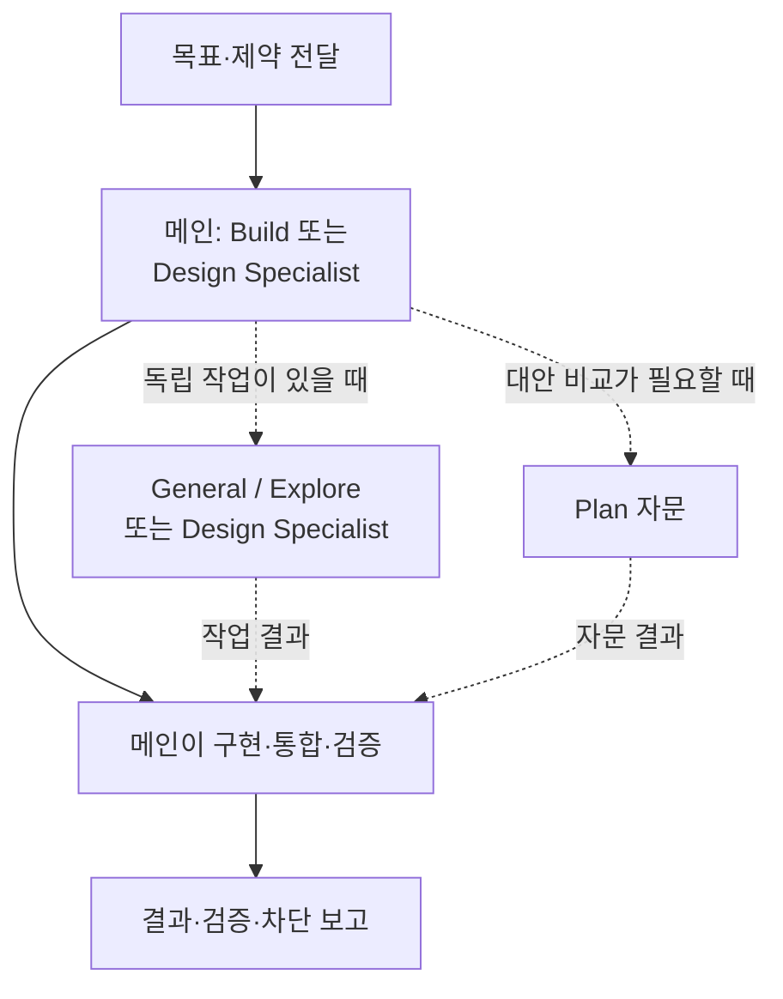

# KSI OpenCode Harness

Build가 개발을 구현·통합하고 Design Specialist가 UI/UX 작업을 조사·구현·렌더 검증하도록 안내하는 OpenCode Native 전역 하네스입니다. 이 저장소는 전역 설정의 정본과 제한된 UI 소스 검사 도구를 관리합니다. 별도 실행 프레임워크·설치기·자동 재개 플러그인은 제공하지 않으며, 저장소를 clone/pull해도 전역 설정에 자동 적용되지는 않습니다.

**빠른 이동:** [역할 선택과 첫 요청](#역할-선택과-첫-요청) · [전역 설치·갱신](#전역-설치-또는-갱신) · [정본과 적용 경로](#전역-정본과-배포) · [UI 작업과 검증](#ui-작업-도구와-검증) · [Detector 범위](#impeccable-detector) · [검증 명령](#검증-명령)

## 역할 선택과 첫 요청

먼저 OpenCode에서 **메인 에이전트**를 선택한 다음, 일반 문장으로 할 일을 요청하세요. `@agent` 형식이나 새 명령은 필요하지 않습니다.

**바로 시작하기:** 에이전트 선택기에서 Build를 골라 개발을 맡기거나, UI/UX 작업이면 Design Specialist를 메인으로 선택한 뒤 예시처럼 요청하세요.

- **Build:** “주문 내역 CSV 내보내기를 구현해줘. 기존 권한·API 계약을 유지하고 관련 테스트와 실제 흐름을 검증해줘.”
- **Design Specialist:** “결제 완료 흐름을 개선해줘. 기존 제품 패턴과 상태를 확인하고 구현한 다음 실제 렌더와 상호작용을 검증해줘. 권한·데이터 계약은 유지해줘.”

| 역할 | 맡길 일 |
| --- | --- |
| **Build** | 개발 전반의 구현·통합·최종 검증을 책임지는 기본 메인 에이전트. 독립 작업을 나누더라도 전체 결과를 통합합니다. 주요 UI/UX 작업은 Design Specialist에 위임하거나 그 역할을 메인으로 선택할 수 있습니다. |
| **Design Specialist** | UI/UX 변경의 조사·판단·구현·실제 렌더 및 상호작용 검증을 담당합니다. 제품 화면이나 핵심 흐름을 주로 바꾸는 일은 이 역할을 메인으로 선택할 수 있습니다. |
| **General** | 메인 에이전트가 맡기는 독립 구현·테스트·조사 작업 단위. 목적·범위·소유권·계약·완료 조건을 전달하고, 결과·근거·검증·남은 위험을 받습니다. |
| **Explore** | 저장소와 코드를 읽기 전용으로 빠르게 찾고 탐색합니다. |
| **Plan** | 필요한 경우에만 대안·위험·검증 방법을 제안하는 선택형 자문입니다. `global/opencode.jsonc`의 `mode: "all"`로 Plan 자체를 메인 또는 하위로 선택할 수 있으며 전용 모델 바인딩은 없습니다. 필수 선행 단계나 승인 게이트가 아닙니다. |



**Plan은 선택형 자문입니다.**

- **Build:** 미결정 아키텍처, 여러 모듈에 걸친 변경, 마이그레이션, 호환성 또는 회귀 위험의 대안을 비교해야 할 때 선택적으로 자문합니다.
- **Design Specialist 메인:** UI 작업이 권한·API·데이터 또는 여러 화면에 걸치고 구현 경계나 대안이 불명확할 때 선택적으로 자문합니다.
- 단순 스타일 수정·경계가 정해진 수정은 직접 진행하고, 필요한 UX 방법론만 Intent 스킬로 선택합니다. Plan 결과를 받은 원래 메인 에이전트가 결정하고 범위 내 실행을 이어갑니다. 권한 밖 제품 결정은 사용자에게 질문합니다.
- 현재 Native 중첩 기본값은 1단계입니다. 하위 Design Specialist가 추가 Plan 자문을 호출할 수 없으면 미결정 질문을 메인 Build에 돌려줄 수 있습니다.

**선택형 Intent 요청 예시:** “주문 취소 흐름을 `@journey`로 점검해줘”, “관리자 메뉴를 `@organize`로 재구성해줘”, “구조 대안 두 가지를 `@wireframe`으로 HTML 비교해줘”. 원본 스킬의 질문·산출물 조건을 따릅니다.

## 전역 설치 또는 갱신

파일 수정·명령 실행이 가능한 에이전트에게 아래 프롬프트를 전달할 수 있습니다. 설치는 개인 환경에서 명시적으로 진행하며, 매 작업마다 외부 도구를 자동 업데이트하지 않습니다.

<details>
<summary>전역 설치 요청 프롬프트 보기</summary>

```text
https://github.com/khakisketch/KSI-Opencode-Harness 의 main을 확인하고,
README와 global/ 정본을 기준으로 내 OpenCode 전역 환경에 하네스를 설치해줘.
1. OS·실제 전역 경로·기존 설치·Node.js·브라우저를 확인하고,
   기존 파일을 백업한 뒤 관련 항목만 병합해줘. 개인 설정·자격증명·다른 도구는
   보존하고, 같은 이름의 사용자 정의와 충돌하면 필요한 선택만 질문해줘.
2. global/AGENTS.md, global/agents/design-specialist.md, global/opencode.jsonc를
   전역에 적용하고 필요한 환경별 경로 차이를 보고해줘.
   global/plugins/ksi-impeccable-detector/도 전역 plugins/에 적용해줘.
   OpenCode V2가 자동 발견하므로 중복 plugins 등록이나 npm 설치는 하지 마.
   프로젝트에 지침을 중복 삽입하지 말고 V2 공식 문서와 실제 설정을 확인해줘.
3. 기존 Impeccable 설치를 확인하고, 새 설치나 명시적 갱신이 필요할 때만
   공식 npm `latest` 태그를 사용해줘. 명령은 다음과 같아:
   npx --yes impeccable@latest install --providers=opencode --scope=global --no-hooks
   실제로 해결된 버전과 공식 출처를 기록하고 detect와 Native 연동을 검증해줘.
   기존 설치가 확인한 latest와 같으면 재설치하지 마. 버전 번호를 고정 요구하지 말고,
   매 작업마다 자동 업데이트하지 마. 최신 배포본의 자동 훅 지원은 확인 없이 단정하지 마.
   Intent는 아래 공식 1.7.1 출처에서 journey·organize·wireframe만 전역 설치하고,
   각 스킬의 원본 참고 자료도 보존해줘. --all·6개 에이전트·추가 훅은 설치하지 마.
   기존 스킬·전역 lock을 확인하고 충돌이 없을 때 아래 선택 설치 명령을 적용해줘.
   원본 수정·강제 덮어쓰기·init·프로젝트 문서 생성·타 클라이언트 훅·목록 외 스킬
   추가는 하지 마. 제품 코드·데이터와 다른 세션·서비스도 변경하지 마.
4. 연결된 데스크톱에서는 Native Browser, 연결되지 않은 자식·헤드리스 환경이나 반복 자동화에는
   Playwright CLI를 사용할 수 있게 확인해줘. 기존 CLI·Chrome·원본 playwright-cli 스킬을 재사용하고,
   CLI가 없을 때만 공식 @playwright/cli@0.1.22 설치를 검토해줘. 프로젝트 init이나 테스트 의존성
   교체는 하지 말고 Playwright MCP·agent-browser를 기본 도구로 추가하지 마.
5. OpenCode Go·OpenAI 모델 접근과 Mobbin·Context7 인증을 확인해줘.
   필요한 구독·인증만 안내하고, 비밀값을 채팅·저장소에 기록하거나
   비용이 다른 모델로 임의 대체하지 마. OAuth는 사용자가 /mcps에서 진행하게 해줘.
6. 실제 에이전트·모델·MCP·impeccable 및 Intent 3개 스킬 인식과 참고 자료를 확인하고 임시 fixture에서
   detect와 변경 파일 자동 검사 훅을 검증해줘. 적용 완료·인증 대기·실패를 구분하고,
   설치한 Git 커밋·외부 도구 버전·환경별 차이를 보고해줘.
```

</details>

위 절차는 전역 핵심 구성·공식 Impeccable·선택한 Intent 3개 스킬을 재현하며, 현재 운영자의 모든 스킬을 복제하는 설치는 아닙니다. OpenCode Go·OpenAI·Mobbin 이용 권한과 Context7 자격증명은 사용자별로 준비해야 합니다.

| 외부 구성 | 공식 출처·범위 |
| --- | --- |
| Impeccable | [공식 저장소](https://github.com/pbakaus/impeccable), [npm 패키지](https://www.npmjs.com/package/impeccable). 기본은 npm `latest`를 해결한 버전을 기록하고 detect·Native 연동을 확인합니다. 2026-10-15 확인 시 `latest`와 현재 설치본 모두 [4.5.2](https://www.npmjs.com/package/impeccable/v/4.5.2)여서 재설치하지 않았습니다. 4.5.2는 고정 요구가 아닙니다. |
| Intent 선택 설치 | [공식 v1.7.1](https://github.com/ghaida/intent/tree/v1.7.1)의 `journey`·`organize`·`wireframe`과 각 원본 참고 자료만 설치합니다. |
| Playwright CLI | [공식 저장소·원본 스킬](https://github.com/microsoft/playwright-cli). 기존 `@playwright/cli` 0.1.22를 사용하며 MCP는 기본 구성에 포함하지 않습니다. |
| Mobbin·Context7 | `global/opencode.jsonc`의 공식 서비스에 연결하며 사용자별 인증이 필요합니다. |

Intent 선택 설치 명령(POSIX 셸 기준):

```sh
DO_NOT_TRACK=1 npx -y skills@1.7.2 add https://github.com/ghaida/intent/tree/v1.7.1 --skill journey --skill organize --skill wireframe -g -a opencode -y --copy
```

현재 공식 CLI는 이 3개를 `~/.agents/skills/`에 설치하며 OpenCode가 전역 호환 소스로 인식합니다. 공유 스킬 위치와 `~/.agents/.skill-lock.json`의 기존 항목을 보존하고 중복 설치하지 않습니다. Intent 원본은 이 저장소에 복제하지 않으며 `wireframe`의 CSS·JS·스타일가이드도 원본과 함께 설치합니다.

## 전역 정본과 배포

| 저장소 정본 | 전역 적용 위치 | 내용 |
| --- | --- | --- |
| [global/AGENTS.md](global/AGENTS.md) | `~/.config/opencode/AGENTS.md` | 제품 완성·질문·위임·검증 기준 |
| [global/agents/design-specialist.md](global/agents/design-specialist.md) | `~/.config/opencode/agents/design-specialist.md` | 디자인 역할·모델·브라우저 권한 |
| [global/opencode.jsonc](global/opencode.jsonc) | `~/.config/opencode/opencode.jsonc` | Native 역할 라우팅·모델 요청 설정·MCP·출력·문맥 설정 |
| [global/plugins/ksi-impeccable-detector/](global/plugins/ksi-impeccable-detector/) | `~/.config/opencode/plugins/ksi-impeccable-detector/` | 허용된 UI 편집 뒤 원본 엔진의 제한된 소스 검사 |

정본은 **수정 → 전역 반영 → 검증 → 커밋·푸시** 순으로 관리합니다. 기존 설정이 있는 환경에서는 관련 항목만 병합하고 공통 지침을 프로젝트에 중복 삽입하지 않습니다.

현재 환경과 배포 정본의 일치는 다음으로 비교할 수 있습니다.

```sh
cmp global/AGENTS.md ~/.config/opencode/AGENTS.md
cmp global/agents/design-specialist.md ~/.config/opencode/agents/design-specialist.md
cmp global/opencode.jsonc ~/.config/opencode/opencode.jsonc
diff -r global/plugins/ksi-impeccable-detector ~/.config/opencode/plugins/ksi-impeccable-detector
```

Context7 자격증명은 `CONTEXT7_API_KEY` 환경변수로 주입하며 실제 키는 저장소에 넣지 않습니다. 계정·OAuth 토큰·서비스 상태·세션·개인 `cli.json`·도구별 독립 스킬은 배포 사본에 포함하지 않습니다. 브라우저 검증 산출물은 작업별 `/tmp/opencode` 경로에 두고 CLI는 고유한 명명 세션을 씁니다. 다른 프로젝트가 사용하는 공유 CLI·공식 스킬·브라우저 세션은 임의 삭제하거나 종료하지 않습니다.

제품별 요구사항과 검증은 해당 프로젝트의 기존 문서·테스트·CI에서 관리합니다. 실행·설정·권한은 [OpenCode V2 공식 문서](https://opencode.ai/v2/docs/)와 실제 설정을 따릅니다.

## 작업 방식

- 기본은 OpenCode Native 세션·계획·대화 이력·compaction입니다. 고정 계획·체크포인트 경로나 새 관리 파일을 의무화하지 않고 기존 프로젝트 관례를 따릅니다.
- 긴 조사·진단과 독립 구현·테스트는 명령별이 아니라 전체 작업 단위로 나눕니다. 각 상태 공유 자원(예: VM)은 한 담당자만 맡고 메인 에이전트가 통합합니다.
- 승인 범위 안의 남은 실행 가능한 일이 있으면 마일스톤·커밋·검사 통과 뒤에도 “계속/다음 진행” 승인을 다시 요구하지 않습니다. 기존 증거는 재사용하고 통합 영향·미확인 동작만 추가 확인합니다.
- 최종 보고 전에는 실제 완료·차단·미승인 범위를 대조하고, 기존 원장이 있으면 참고합니다. 새 범위·비용·보안 결정은 기존 승인 경계를 유지합니다. 이는 모델의 종료 판단 지침이지 자동 재개 장치가 아닙니다.
- 하네스 절차는 실제 세션 기록에서 반복 문제가 확인될 때 최소한으로 개선합니다. 독립 Reviewer를 상시 추가하거나 추측으로 새 관리 체계를 만들지 않습니다.

## UI 작업 도구와 검증

도구는 필요한 경우에 선택하며 아래 표는 필수 순서가 아닙니다.

| 필요한 일 | 선택 수단 |
| --- | --- |
| 실제 제품 패턴 비교 | 기존 제품, 전문 제품의 공식 화면·문서·데모, 필요할 때 Mobbin |
| 라이브러리·구현 정보 | Context7 |
| 실제 동작·화면·관련 상태 확인 | 연결된 데스크톱은 Native Browser 우선, 연결되지 않은 자식·SSH·헤드리스 환경이나 반복 자동화는 기존 Playwright CLI |
| 제한된 소스 결함 검사 | Impeccable standalone `detect` 또는 아래 KSI detector |
| 정식 디자인 비평 | 원본 Impeccable의 해당 스킬 명령 |
| 업무 흐름·중단·복귀 | 필요할 때 Intent `journey` |
| 메뉴·분류·검색·정보 탐색 구조 | 필요할 때 Intent `organize` |
| 별도 화면 구조 대안·클릭 프로토타입 | 필요할 때 Intent `wireframe` |

작은 수정에는 불필요한 조사·검사를 생략합니다. 중요한 구조 변경은 사용자 업무·상태·제약을 기준으로 판단합니다.

- 참고 화면은 실제 이미지로 보고 관찰 사실과 해석을 구분하며, 채택한 패턴을 사용자 과업에 연결합니다.
- UI 변경은 구현 후 실제 렌더와 관련 상태를 확인하고, 실행한 상호작용만 검증했다고 보고합니다. 캡처 경로만 확인한 것은 이미지 검증이 아닙니다.
- 와이어프레임의 회색 키트·다이어그램 스타일을 제품 디자인에 옮기지 않습니다. 색상·타이포·시각적 구현은 제품 디자인 체계를 따릅니다. React/Next.js 코드를 작성하는 Design Specialist는 사용자가 설치한 Vercel React Best Practices를 참고할 수 있습니다.

- Playwright MCP와 `agent-browser`는 기본 도구가 아닙니다. 기존 `agent-browser` 전역 패키지와 전용 OpenCode 스킬 링크는 명시적 승인 후 제거했습니다.
- Playwright CLI는 기존 CLI·Chrome·원본 `playwright-cli` 스킬을 재사용하고, 없을 때만 공식 `@playwright/cli@0.1.22`를 검토합니다. 프로젝트 init이나 테스트 의존성 교체는 하지 않습니다.
- CLI는 고유한 세션 이름을 쓰고 자신이 만든 세션만 종료합니다. `close-all`·`kill-all` 등 전체 세션 정리는 사용하지 않으며 기존 캡처·로그·프로젝트의 Playwright Test와 감사 스크립트는 보존합니다.

2026-10-15 Linux arm64 / OpenCode 2.0.29에서 Native Browser의 외부 페이지·캡처·기본 클릭을 확인했습니다. 하네스 위치에서 Playwright MCP를 비활성화한 뒤 Design Specialist 자식 세션에서 CLI 0.1.22를 `DISPLAY`·`WAYLAND_DISPLAY` 없이 실행해 외부 화면, 로컬 상태 전환, PNG 3개 읽기를 확인했습니다. 자식 종료 후 별도 보호 세션의 상태도 유지됨을 확인하고 전역 MCP 항목을 제거했습니다. 이는 도구 경로 검증일 뿐 실제 제품 UI 품질이나 다른 OS·원격 SSH 환경 전체의 검증은 아닙니다.

Impeccable은 [공식 저장소의 명령·설치 안내](https://github.com/pbakaus/impeccable)를 따르며 스킬·엔진을 이 저장소에 복제하거나 수정하지 않습니다. 설치 시 해결된 버전과 출처를 기록하고 `detect` 및 Native 연동을 확인합니다. 설치 당시 확인한 버전은 매 작업 자동 갱신하지 않습니다.

<details>
<summary>Impeccable·Intent 사용 범위와 과거 확인 내용</summary>

Intent는 기존 Design Specialist가 필요할 때 쓰는 선택형 방법론입니다. 전체 스킬·에이전트 체인이나 필수 선행 단계는 아닙니다. 기존 제품 문맥·기획·검증 결과를 재사용하고 작은 UI 수정에는 생략합니다. 예시 요청은 위의 `@journey`·`@organize`·`@wireframe`을 참고하세요. 설치·인식 확인이나 검사 통과만으로 실제 사용성·시각 품질 개선이 입증된 것은 아니므로 우선 실제 흐름 하나에서 효과와 작업 부담을 비교합니다.

기존 검증 버전 Impeccable 4.5.2에는 OpenCode 자동 훅이 없어서 KSI detector가 별도로 필요했습니다. 이는 해당 버전의 확인 결과이며 향후 `latest` 배포본의 자동 훅 지원이나 호환성을 보증하지 않습니다. 새 배포본의 동작은 설치·갱신 때 확인합니다.

</details>

## Impeccable detector

전역 Native V2 플러그인 `ksi.impeccable-detector`는 성공한 `write`·`edit`·`patch` 뒤 변경된 대상 UI 소스를 검사하고 기존 도구 결과에 검사 요약을 덧붙입니다. 원본 Impeccable 스킬·엔진을 수정하지 않으며 자동 수정·모델 재호출·검사 결과에 따른 작업 차단을 하지 않습니다.

<details>
<summary>검사 대상·제약·시간 및 크기 한도</summary>

- 세션 디렉터리 안의 UI 파일만 대상으로 합니다. 삭제·비 UI·숨김·의존성·생성 파일은 제외합니다.
- 대상 확장자는 CSS·SCSS·SASS·LESS·HTML·HTM·JSX·TSX·Vue·Svelte·Astro입니다. 일반 JS·TS는 제외합니다.
- 파일 읽기와 엔진 실행은 Native 권한을 확인합니다. 별도 허용 규칙을 더하거나 권한 거부를 우회하지 않습니다.
- 이미 설치된 플랫폼 엔진만 사용합니다. 엔진 누락·실패·시간 초과는 검사 불가로 표시하고 다운로드하지 않습니다.
- 허용된 파일의 복사본만 격리 검사합니다. HTML은 연결된 CSS를 따라가지 않는 정규식 검사입니다. 프로젝트 설정·디자인 시스템을 읽지 않고 URL·렌더·전체 프로젝트 검사를 자동 실행하지 않습니다.
- `--no-config` 검사라 프로젝트의 무시 설정도 적용되지 않습니다. 경고는 맥락을 보고 판단합니다.
- 세션·에이전트·내용·엔진이 같은 경우 유효한 결과를 재사용합니다. 파일당 최대 512 KiB, 엔진 실행 1.5초(종료 정리는 별도), 편집당 최대 8파일·6초 검사 예산으로 제한하고 대기열을 쌓지 않습니다.
- 한도 초과나 동시 검사 중 생략은 결과에 표시합니다. 쉘 명령·외부 편집기는 이 훅의 범위 밖입니다.

</details>

검증 환경은 OpenCode **2.0.29 / Linux arm64**입니다. 다른 OS는 별도 확인이 필요합니다. 플러그인 의존성은 OpenCode 런타임이 제공하므로 이 폴더에서 `npm install`하지 않습니다. 비활성화하려면 프로젝트 또는 전역 설정의 `plugins` 목록에 `"-ksi.impeccable-detector"`를 추가합니다. 전역 자동 재로딩을 확인하고 다른 세션이 실행 중이면 서비스를 임의 재시작하지 않습니다.

## 검증 명령

Detector의 빠른 테스트와 Native 통합 검사는 다음과 같습니다.

```sh
node --test tests/core.test.mjs tests/adapter.test.mjs
node tests/native-hook-integration.mjs
```

Native 통합 검사는 고유한 임시 HOME·별도 포트·로컬 모의 모델을 사용하므로 실제 모델 비용이 들지 않습니다. 임시 증빙은 `/tmp/opencode/ksi-native-*`에 남기며 기존 폴더를 지우거나 공유 서비스를 재시작하지 않습니다.

종료 판단 지침의 기본 회귀 검사는 다음과 같습니다.

```sh
node --test tests/completion-guidance.test.mjs
```

<details>
<summary>선택형 실모델 검사와 해석 범위</summary>

`node tests/completion-guidance-live.mjs --phase after --case all`은 **선택형 실모델 검사**이며 현재 연결된 OpenCode Go의 `deepseek-v4.1-flash#max`를 사용해 계정 사용량을 소비합니다. 고유한 `/tmp/opencode` 작업 공간에서 중간 완료 후 계속 실행·외부 blocker와 독립 작업·범위 경계를 확인하고 케이스당 사용자 프롬프트를 한 번만 보냅니다. `--phase`는 증빙 구분용이며 적용 지침 버전을 바꾸지 않습니다. 작은 fixture 통과는 긴 프로젝트에서 같은 문제가 재발하지 않는다는 증거가 아닙니다.

2026-10-15 확인에서는 기존·수정 지침 모두 3/3 완주했습니다. 수정 후 검사는 시험용 권한도 좁혔으므로 기능 회귀 확인으로만 해석합니다. 지침 변경의 개선 효과나 긴 세션 문제 해결을 입증하는 A/B 결과는 아닙니다.

</details>

[MIT](LICENSE) — Copyright (c) 2026 KSI
